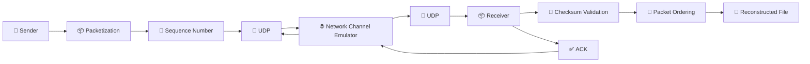
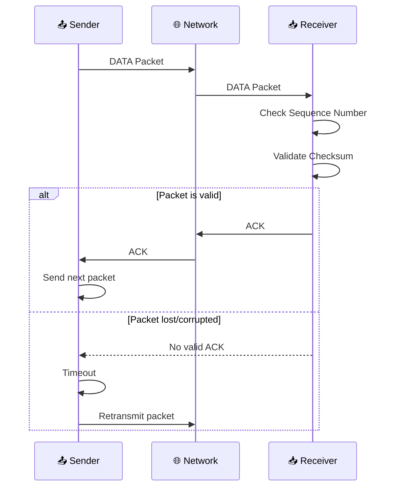
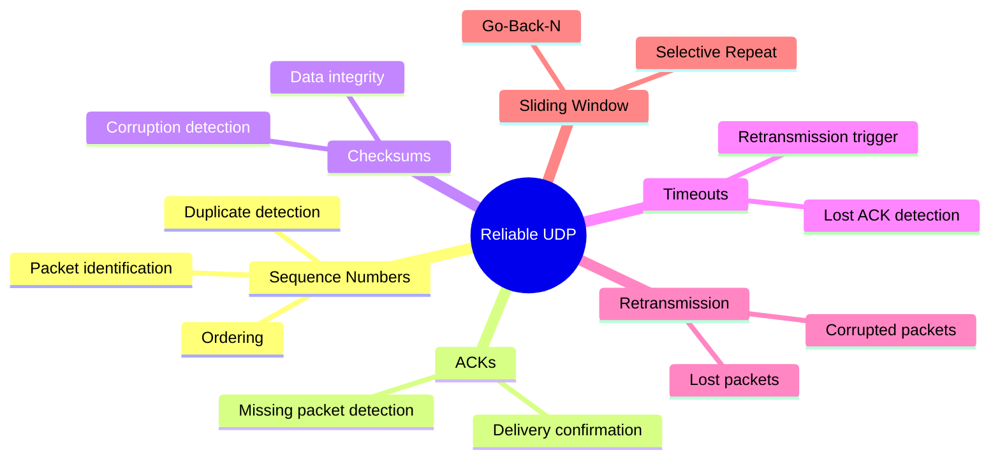
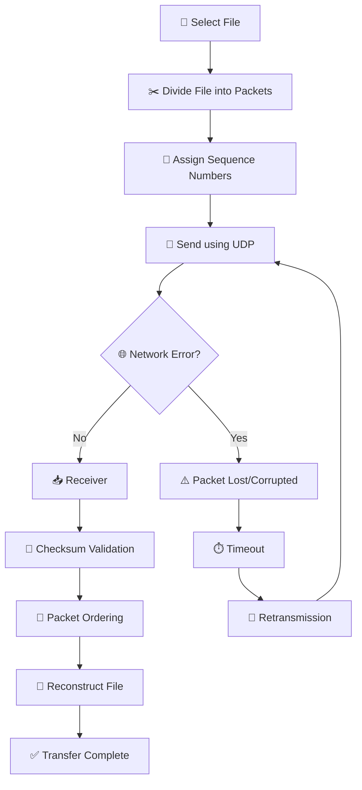

# 🚀 Reliable Data Transfer over UDP

<p align="center">
  
  
  
  
  
</p>

<p align="center">
  <b>A reliable file-transfer system built on top of UDP</b>
</p>

<p align="center">
  <i>Implementing Stop-and-Wait, Go-Back-N and Selective Repeat ARQ protocols</i>
</p>

---

## 📌 About the Project

**Reliable Data Transfer over UDP** is a computer networking project that demonstrates how reliable communication can be achieved over the inherently unreliable **UDP protocol**.

UDP provides fast, connectionless communication, but it does not guarantee:

- ❌ Packet delivery
- ❌ Packet ordering
- ❌ Duplicate-free delivery
- ❌ Data integrity
- ❌ Retransmission of lost packets

This project adds reliability mechanisms at the application layer using **ARQ (Automatic Repeat reQuest)** protocols.

### ✨ Main Features

| Feature | Description |
|---|---|
| 🔄 Stop-and-Wait | Sends one packet and waits for ACK |
| 📦 Go-Back-N | Uses a sliding window and retransmits from the lost packet |
| 🎯 Selective Repeat | Retransmits only missing/corrupted packets |
| 🔢 Sequence Numbers | Identifies and orders packets |
| ✅ ACKs | Confirms successful packet reception |
| 🔐 Checksums | Detects corrupted packets |
| ⏱️ Timeout | Detects lost packets/ACKs |
| 🔁 Retransmission | Recovers lost or corrupted packets |
| 🌐 Network Emulator | Simulates unreliable network conditions |
| 📁 File Transfer | Transfers files reliably over UDP |

---

# 🏗️ System Architecture



---

# 🔄 How Reliable Transfer Works



---

# 🧩 ARQ Protocols

## 1️⃣ Stop-and-Wait ARQ

The sender transmits **one packet at a time** and waits for its acknowledgment.

```text
┌────────────┐                         ┌────────────┐
│   Sender   │                         │  Receiver  │
└─────┬──────┘                         └─────┬──────┘
      │                                      │
      │────────── DATA 1 ──────────────────>│
      │                                      │
      │<────────── ACK 1 ───────────────────│
      │                                      │
      │────────── DATA 2 ──────────────────>│
      │                                      │
      │<────────── ACK 2 ───────────────────│
      │                                      │
```

### ✅ Advantages

- Simple implementation
- Easy error recovery
- Low receiver complexity

### ❌ Disadvantage

- Low throughput because the sender waits after every packet

---

# 2️⃣ Go-Back-N ARQ

Go-Back-N allows multiple packets to be transmitted using a **sliding window**.

If a packet is lost, the sender retransmits that packet and all subsequent packets in the window.

```text
Sender

DATA 1 ────────────────────────────────>
DATA 2 ────────────────────────────────>
DATA 3 ────────────────X  LOST
DATA 4 ────────────────────────────────>

Receiver

ACK 1 <────────────────────────────────
ACK 2 <────────────────────────────────

             DATA 3 LOST

Sender retransmits:

DATA 3 ────────────────────────────────>
DATA 4 ────────────────────────────────>
```

### ✅ Advantages

- Better throughput than Stop-and-Wait
- Multiple packets can be in transit

### ❌ Disadvantage

- Correct packets after the lost packet may need retransmission

---

# 3️⃣ Selective Repeat ARQ

Selective Repeat retransmits **only the packets that are missing or corrupted**.

```text
Sender                         Receiver

DATA 1 ────────────────────────>
DATA 2 ────────────────────────>
DATA 3 ───────────X LOST
DATA 4 ────────────────────────>

ACK 1 <────────────────────────
ACK 2 <────────────────────────
ACK 4 <────────────────────────

DATA 3 ────────────────────────>
```

### ✅ Advantages

- Efficient bandwidth usage
- Only missing packets are retransmitted
- Suitable for unreliable networks

### ❌ Disadvantages

- More complex
- Requires receiver buffering

---

# ⚖️ Protocol Comparison

| Feature | 🛑 Stop-and-Wait | 🔁 Go-Back-N | 🎯 Selective Repeat |
|:---|:---:|:---:|:---:|
| Multiple packets in transit | ❌ | ✅ | ✅ |
| Sliding window | ❌ | ✅ | ✅ |
| Retransmission | One packet | Multiple packets | Only required packets |
| Receiver buffering | Low | Low | High |
| Complexity | ⭐ | ⭐⭐ | ⭐⭐⭐ |
| Throughput | Low | Medium/High | High |
| Loss efficiency | Low | Medium | High |

---

# 🛡️ Reliability Mechanisms



---

# 🌐 Network Channel Emulator

The project can simulate an unreliable network environment.

### The emulator can introduce:

```text
        🌐 NETWORK CHANNEL
               │
     ┌─────────┼─────────┐
     │         │         │
     ▼         ▼         ▼
  📉 Loss   ⚡ Delay   💥 Corruption
     │         │         │
     └─────────┼─────────┘
               │
        ┌──────┴──────┐
        ▼             ▼
     🔁 Duplicate   🔀 Reorder
```

| Network Condition | Purpose |
|---|---|
| 📉 Packet Loss | Tests retransmission |
| 💥 Corruption | Tests checksum validation |
| ⚡ Delay | Tests timeout handling |
| 🔁 Duplication | Tests duplicate detection |
| 🔀 Reordering | Tests packet ordering |

---

# 📦 Packet Structure

```text
┌──────────────────────────┐
│      Packet Type         │
├──────────────────────────┤
│      Sequence Number     │
├──────────────────────────┤
│      Payload Length      │
├──────────────────────────┤
│      Checksum            │
├──────────────────────────┤
│                          │
│         Payload          │
│                          │
└──────────────────────────┘
```

### Packet Components

| Component | Purpose |
|---|---|
| 🏷️ Packet Type | Identifies packet/control type |
| 🔢 Sequence Number | Identifies packet position |
| 📏 Payload Length | Indicates payload size |
| 🔐 Checksum | Detects corruption |
| 📄 Payload | Contains transferred data |

---

# 📁 Project Structure

```text
Reliable-Data-Transfer-over-UDP/
│
├── 📁 data/
│   └── Files used for testing
│
├── 📁 src/
│   │
│   ├── 📁 common/
│   │   ├── packet.py
│   │   ├── checksum.py
│   │   └── config.py
│   │
│   └── Protocol implementations
│
├── 📄 AI-USE.md
│
└── 📄 README.md
```

---

# ⚙️ Technologies Used

<p align="center">

| Technology | Usage |
|:---:|:---|
| 🐍 Python | Main programming language |
| 📡 UDP | Transport protocol |
| 🔌 Socket Programming | Network communication |
| 🔄 ARQ | Reliable data transfer |
| 🔐 Checksum | Data integrity |
| 🔢 Sequence Numbers | Packet identification |
| ✅ ACK | Delivery confirmation |
| 🌐 Network Emulator | Network-error simulation |
| 🐙 Git/GitHub | Version control |

</p>

---

# 🚀 Running the Project

## 1. Clone the Repository

```bash
git clone https://github.com/dxsougata/Reliable-Data-Transfer-over-UDP.git
```

## 2. Enter the Project

```bash
cd Reliable-Data-Transfer-over-UDP
```

## 3. Start the Receiver

Open **Terminal 1**:

```text
Receiver
   ▲
   │
   │ UDP
   │
   ▼
Sender
```

Run the appropriate receiver entry point from the `src` directory.

## 4. Start the Sender

Open **Terminal 2**:

```text
Run the appropriate sender entry point from src
```

The sender and receiver then communicate using UDP.

> ℹ️ The exact command depends on the protocol/entry point configured in the current source code.

---

# 🔬 Testing

The project can be tested under different network conditions.

### Example Test Matrix

| Test | Network Condition | Expected Result |
|---|---|---|
| Test 1 | No packet loss | Successful transfer |
| Test 2 | Packet loss | Retransmission |
| Test 3 | Packet corruption | Checksum detects error |
| Test 4 | Packet delay | Timeout/retransmission |
| Test 5 | Packet duplication | Duplicate detection |
| Test 6 | Packet reordering | Correct packet ordering |

---

# 📊 File Transfer Flow



---

# 🎯 Learning Outcomes

Through this project, we learned:

- 📡 UDP socket programming
- 🔄 Reliable communication over UDP
- 🧠 ARQ protocols
- 🔢 Sequence numbering
- ✅ Acknowledgment mechanisms
- 🔐 Checksums
- ⏱️ Timeout handling
- 🔁 Retransmission
- 🪟 Sliding-window protocols
- 🌐 Network-error simulation
- 📁 Reliable file transfer
- 🐙 Git and GitHub collaboration

---

# 👨‍💻 Git Workflow

For team development, feature branches can be used.

```bash
# Get latest changes
git pull origin main

# Create a feature branch
git checkout -b feature-name

# Check changes
git status

# Add changes
git add .

# Commit changes
git commit -m "Add feature"

# Push branch
git push -u origin feature-name
```

Then create a **Pull Request** on GitHub to merge the branch into `main`.

---

# 🔮 Future Improvements

- 📊 Real-time transfer statistics
- 📈 Throughput graphs
- 📉 Packet-loss graphs
- ⏱️ RTT and timeout analysis
- 🖥️ Graphical user interface
- 🧪 Automated protocol testing
- 📝 Detailed transfer logs
- ⚙️ More configurable network conditions
- 📊 Performance comparison between ARQ protocols

---

# 🏁 Conclusion

This project demonstrates how **reliable data transfer can be built on top of UDP**.

By implementing:

```text
        UDP
         │
         ▼
┌─────────────────────┐
│ Reliable Transfer   │
├─────────────────────┤
│ Sequence Numbers    │
│ ACKs                │
│ Checksums           │
│ Timeouts            │
│ Retransmission      │
└─────────────────────┘
         │
         ▼
   Reliable File
      Transfer
```

the project overcomes the reliability limitations of UDP.

The implementation of **Stop-and-Wait, Go-Back-N, and Selective Repeat** also provides a practical comparison of different ARQ strategies under unreliable network conditions.

---

<p align="center">
  <b>🚀 Reliable Data Transfer over UDP</b>
  <br>
  <i>Computer Networks Project</i>
</p>
